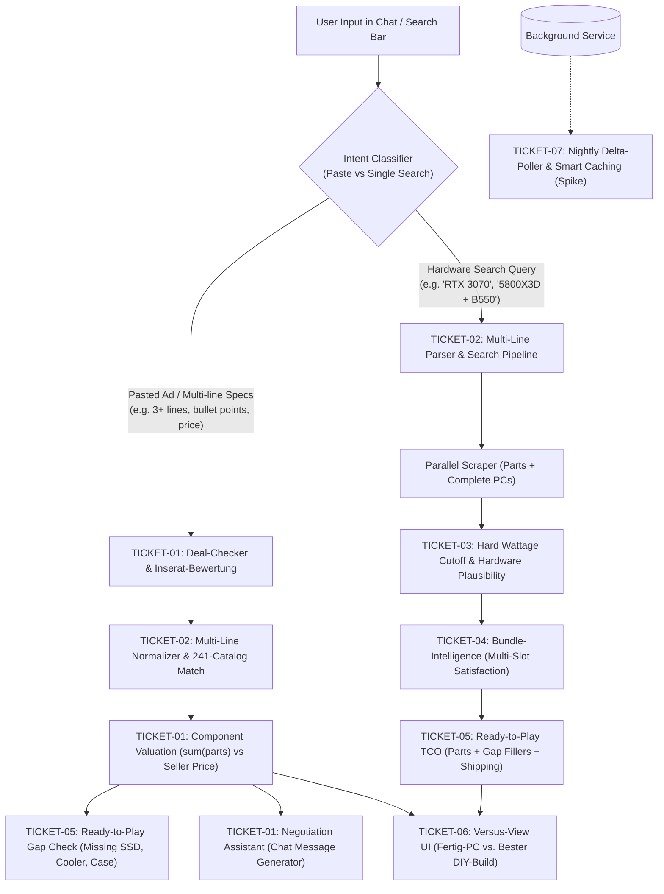

# Sprint 3 Architectural Specification & Implementation Blueprint
**Project:** `kleinanzeigen-gaming-pc-crawler`  
**Author:** Lead Architect (Team 1: Planning & Architecture)  
**Target:** Team 2 (Core Implementation) & Team 3 (Browser QA / Certification)  
**Status:** Approved Architectural Specification  
**Date:** 2026-11-08  

---

## 1. Executive Summary & Architectural Overview

Sprint 3 transforms the *Kleinanzeigen Gaming-PC Crawler* from a pure component-search tool into an **autonomous hardware evaluation & comparison platform**. 

### The Core Challenges of Sprint 3
1. **Paste-to-Evaluate (Deal-Checker)**: Users frequently paste an entire Kleinanzeigen ad (title + multi-line specs + price) into the search bar. Currently, the crawler misunderstands this as a query to *buy* these parts individually across Kleinanzeigen, leading to noisy multi-term searches. The system must immediately distinguish between an ad evaluation intent ("Evaluate Deal") and a component search intent ("Find Parts").
2. **Multi-Line Parser Hardening**: In Session `sess_20261108_122052_2abad8.jsonl`, a user pasted 8 lines of specs (Ryzen 5800X3D, B450-F, 32GB RAM, RTX 3080, 1TB NVMe, Seasonic 650W, Pure Base 500, Dark Rock Pro 4). The parser failed by concatenating lines into noisy queries, dropping the Motherboard, RAM, SSD, Case, and Cooler entirely, and extracting only 3 specs.
3. **Hard Hardware Plausibility & Wattage Cutoff**: In that same session, `CombinationEngine` selected a cheap **400W PSU (10€)** for an RTX 3080 (320W TDP) + Ryzen 7 5800X3D (105W TDP) setup because candidate selection was solely price-sorted. Physical plausibility checks must hard-block hazardous or underpowered parts **before** any sorting occurs.
4. **Bundle Intelligence**: Kleinanzeigen listings often sell bundles (e.g. CPU + Motherboard + RAM for 290€). Currently, `CombinationEngine` assigns the bundle to the CPU slot and still buys a redundant motherboard and RAM kit separately. Bundles must satisfy multiple build slots simultaneously.
5. **Ready-to-Play Gap Filling & True Cost of Ownership**: Virtual builds without a case, cooler, or storage are not operational. The system must compute the true ready-to-play cost by adding standard, realistic market prices for missing items (+50€ Case, +30€ Cooler, +55€ SSD) and factoring in per-listing shipping costs.
6. **Versus-View UI**: A head-to-head showdown UI in Streamlit comparing a found Kleinanzeigen complete PC against the best virtual DIY build across total cost, performance, and risk.
7. **Nightly Delta-Poller & Smart Caching (Spike)**: A resilient architectural design for background polling of page-1 results, caching listings in SQLite, and tracking price drops and ad status.

---

## 2. Pre-Implementation Logging & Telemetry Strategy (Mandatory Rule)

In accordance with Section 2 of `rules.md`, **logging and telemetry schemas must be specified before writing implementation code**. All events must be logged to the session JSONL stream (`logs/sessions/<session_id>.jsonl`) using thread-safe locking.

```
+---------------------------------------------------------------------------------------+
|                               Session JSONL Event Stream                              |
+------------------------------------+--------------------------------------------------+
| Event Type                         | Trigger & Payload Contents                       |
+------------------------------------+--------------------------------------------------+
| intent_type_detected               | Intent Classifier: Mode (SEARCH vs DEAL_CHECK),  |
|                                    | confidence, extracted specs, unparsed lines, ms  |
+------------------------------------+--------------------------------------------------+
| deal_check_evaluated               | Deal Checker: Component valuations, total market |
|                                    | value, seller price, savings, assessment rating  |
+------------------------------------+--------------------------------------------------+
| hardware_plausibility_rejected     | Wattage/Platform Cutoff: Rejected component name,|
|                                    | type, required vs actual wattage, reason string  |
+------------------------------------+--------------------------------------------------+
| bundle_slot_satisfied              | Bundle Engine: Multi-slot satisfaction, bundle   |
|                                    | ID, satisfied slots (e.g. CPU+MB+RAM), savings   |
+------------------------------------+--------------------------------------------------+
| ready_to_play_gap_filled           | Gap Filler: Missing categories filled, standard  |
|                                    | unit prices, shipping buffer, final TCO price    |
+------------------------------------+--------------------------------------------------+
| telemetry_summary                  | End of Session: Durations per phase, traffic,    |
|                                    | HTTP status codes, browser client timings        |
+------------------------------------+--------------------------------------------------+
```

### Detailed Event Schemas

#### 1. Inserat-Erkennung & Intent (`intent_type_detected`)
- **Location**: `hardware_crawler/agents.py` (`HardwareIntentAgent.classify_intent`)
- **Timing**: Immediately upon receiving raw user input.
- **Payload Schema**:
  ```json
  {
    "event_type": "intent_type_detected",
    "data": {
      "raw_input_preview": "- Mainboard Asus Strix B450-F Gaming\n- RAM 32GB...",
      "line_count": 8,
      "detected_mode": "DEAL_CHECK_PASTE", // "DEAL_CHECK_PASTE" | "PARTIAL_SEARCH" | "SINGLE_SEARCH"
      "mode_confidence": 0.98,
      "detected_seller_price": 850.0,
      "is_vb": true,
      "extracted_components_count": 8,
      "unrecognized_lines": [],
      "latency_ms": 1.4
    }
  }
  ```

#### 2. Einzelteil-Bewertung (`deal_check_evaluated`)
- **Location**: `hardware_crawler/deal_checker.py` (`DealChecker.evaluate_ad`)
- **Timing**: When an ad is evaluated against the catalog and market pricing.
- **Payload Schema**:
  ```json
  {
    "event_type": "deal_check_evaluated",
    "data": {
      "seller_asking_price": 850.0,
      "is_vb": true,
      "total_part_market_value": 985.0,
      "arbitrage_savings": 135.0,
      "savings_percent": 13.7,
      "price_assessment": "FAIR_DEAL", // "TOP_DEAL" | "FAIR_DEAL" | "OVERPRICED"
      "components": [
        {
          "category": "GPU",
          "raw_name": "ASUS TUF RTX 3080 10GB",
          "canonical_name": "NVIDIA GeForce RTX 3080 10GB",
          "catalog_match_id": "gpu_rtx_3080_10gb",
          "market_value_fair": 420.0,
          "is_catalog_match": true,
          "confidence": 0.99
        },
        {
          "category": "CPU",
          "raw_name": "AMD Ryzen 7 5800X3D",
          "canonical_name": "AMD Ryzen 7 5800X3D",
          "catalog_match_id": "cpu_ryzen_7_5800x3d",
          "market_value_fair": 220.0,
          "is_catalog_match": true,
          "confidence": 1.0
        }
      ],
      "negotiation_target_price": 750.0
    }
  }
  ```

#### 3. Hardware-Plausibilität (`hardware_plausibility_rejected`)
- **Location**: `hardware_crawler/analysis.py` (`CombinationEngine._filter_plausible_components`)
- **Timing**: When a component is blocked by physical compatibility or wattage cutoffs before price sorting.
- **Payload Schema**:
  ```json
  {
    "event_type": "hardware_plausibility_rejected",
    "data": {
      "rejected_listing_title": "HKC PC Netzteil 400W ATX Power Supply",
      "component_type": "PSU",
      "listing_price": 10.0,
      "rule_violated": "HARD_WATTAGE_CUTOFF",
      "actual_wattage": 400,
      "required_wattage": 525,
      "recommended_wattage": 650,
      "build_context": {
        "cpu": "AMD Ryzen 7 5800X3D (TDP: 105W)",
        "gpu": "NVIDIA GeForce RTX 3080 10GB (TDP: 320W)",
        "base_system_w": 100
      },
      "rejection_reason": "PSU 400W verworfen: Benötigt mindestens 525W (empfohlen 650W) für RTX 3080 + Ryzen 5800X3D"
    }
  }
  ```

#### 4. Bundle-Erkennung & Slot-Erfüllung (`bundle_slot_satisfied`)
- **Location**: `hardware_crawler/analysis.py` (`CombinationEngine.create_best_build`)
- **Timing**: When a bundle listing satisfies two or more build slots.
- **Payload Schema**:
  ```json
  {
    "event_type": "bundle_slot_satisfied",
    "data": {
      "bundle_listing_id": "kleinanzeigen_35649182",
      "bundle_title": "Bundle AMD Ryzen 7 5800X3D, MSI x570 Carbon Pro Wifi und 32GB RAM",
      "bundle_price": 290.0,
      "satisfied_slots": ["CPU", "MOTHERBOARD", "RAM"],
      "separate_slots_cost": 380.0,
      "bundle_savings": 90.0
    }
  }
  ```

#### 5. Ready-to-Play Lückenfüllung (`ready_to_play_gap_filled`)
- **Location**: `hardware_crawler/completer.py` / `analysis.py` (`GapAnalyzer.fill_ready_to_play_gaps`)
- **Timing**: During final pricing of virtual builds.
- **Payload Schema**:
  ```json
  {
    "event_type": "ready_to_play_gap_filled",
    "data": {
      "base_components_price": 725.0,
      "shipping_cost_total": 27.96, // 4 listings x 6.99€
      "missing_slots": ["CASE", "COOLER", "STORAGE"],
      "standard_fillers": [
        {"slot": "CASE", "item": "Airflow ATX Gehäuse (Standard)", "price": 50.0},
        {"slot": "COOLER", "item": "Tower CPU-Kühler 120mm (Standard)", "price": 30.0},
        {"slot": "STORAGE", "item": "1TB NVMe M.2 SSD (Standard)", "price": 55.0}
      ],
      "gap_fillers_total": 135.0,
      "true_ready_to_play_price": 887.96
    }
  }
  ```

#### 6. Browser-Telemetrie & Latenz-Tracking
- **Location**: Injected JS snippet via `app.py` & `TrafficMonitor` / `PerformanceTimer`
- **Data Tracked**:
  * Phase latencies: `Intent Parsing & Classification`, `Deal-Checker Valuation`, `Kleinanzeigen Market Scraping`, `Verification & Wattage Cutoff`, `Versus-View Rendering`.
  * Browser client metrics: `domReady` (ms), `pageLoad` (ms), `transferSizeKB`, client JavaScript errors (`window.onerror`).

---

## 3. Detailed Specifications (TICKET-01 to TICKET-07)



---

### TICKET-01: Deal-Checker & Inserat-Bewertung (Paste-to-Evaluate)

#### 1. Requirements & Intent Disambiguation
When a user pastes an ad description from Kleinanzeigen (or a text block), the system must detect that this is a **Deal-Check** request rather than a request to buy those parts.

**Classifier Rules (`detect_deal_check_intent`)**:
An input is classified as `DEAL_CHECK_PASTE` if ANY of the following criteria are met:
1. `line_count >= 3` with 2 or more distinct hardware components.
2. Contains list bullet markers: `- `, `* `, `• `, `1. `, `[x] ` followed by hardware terms.
3. Contains ad boilerplate phrases:
   - `\b(verkaufe|abzugeben|tierfreier\s*nichtraucherhaushalt|nur\s*abholung|funktioniert\s*einwandfrei|zustand\s*wie\s*neu|ovp\s*vorhanden|kein\s*versand)\b` (case-insensitive regex).
4. Contains an embedded price indicator in the text:
   - `\b(\d{2,4})\s*(?:€|euro)\s*(?:vb|festpreis)?\b` or `\bpreis\s*:\s*(\d{2,4})\b`.

If `DEAL_CHECK_PASTE` is detected:
- The system extracts the seller's asking price (or prompts the user for it if missing).
- The system evaluates the ad components using the local 241-item `HardwareCatalog` (0ms).
- The system returns a comprehensive `DealCheckResult`.

#### 2. Domain Models
```python
from dataclasses import dataclass, field
from enum import Enum
from typing import List, Optional, Dict, Any

class PriceAssessment(Enum):
    TOP_DEAL = "TOP_DEAL"        # Savings >= 150€ or >= 20%
    FAIR_DEAL = "FAIR_DEAL"      # -50€ <= Savings < 150€
    OVERPRICED = "OVERPRICED"    # Savings < -50€ (asking price is too high)
    UNKNOWN = "UNKNOWN"

@dataclass
class EvaluatedComponent:
    category: str  # "GPU", "CPU", "MOTHERBOARD", "RAM", "PSU", "STORAGE", "CASE", "COOLER"
    raw_name: str
    canonical_name: str
    catalog_id: Optional[str]
    market_value_min: float
    market_value_max: float
    market_value_fair: float
    is_catalog_match: bool
    confidence: float
    specs_summary: str = ""

@dataclass
class NegotiationStrategy:
    target_offer_price: float
    suggested_discount_pct: float
    rationale: str
    chat_message_german: str

@dataclass
class DealCheckResult:
    seller_asking_price: float
    is_vb: bool
    total_market_value: float
    arbitrage_savings: float       # total_market_value - seller_asking_price
    savings_percent: float         # (arbitrage_savings / total_market_value) * 100
    assessment: PriceAssessment
    assessment_headline: str
    assessment_description: str
    components: List[EvaluatedComponent]
    unrecognized_lines: List[str]
    missing_essential_parts: List[str]
    ready_to_play_additional_cost: float
    ready_to_play_total_cost: float
    negotiation: Optional[NegotiationStrategy] = None
```

#### 3. Valuation Formula
$$\text{total\_market\_value} = \sum_{c \in \text{components}} c.\text{market\_value\_fair}$$
$$\text{arbitrage\_savings} = \text{total\_market\_value} - \text{seller\_asking\_price}$$
$$\text{savings\_percent} = \left(\frac{\text{arbitrage\_savings}}{\text{total\_market\_value}}\right) \times 100$$

**Assessment Boundaries:**
- **`TOP_DEAL`**: $\text{arbitrage\_savings} \ge 150\text{€}$ OR $\text{savings\_percent} \ge 20\%$  
  *Label*: `🔥 Top Deal - Sehr gutes Schnäppchen!`  
  *Recommendation*: Schnell zuschlagen, vor Ort auf Funktion testen.
- **`FAIR_DEAL`**: $-50\text{€} \le \text{arbitrage\_savings} < 150\text{€}$  
  *Label*: `⚖️ Fairer Gebrauchtpreis`  
  *Recommendation*: Guter marktüblicher Preis. Verhandlung um 10% empfohlen.
- **`OVERPRICED`**: $\text{arbitrage\_savings} < -50\text{€}$  
  *Label*: `❌ Zu teuer - Einzelkauf oder Alternativen günstiger`  
  *Recommendation*: Nicht zum Angebotspreis kaufen. Hart nachverhandeln oder weitersuchen.

#### 4. Negotiation Assistant (`NegotiationStrategy`)
Generates polite, realistic, data-backed German chat messages for Kleinanzeigen:
- If `is_vb == True`: Target offer is typically `seller_asking_price * 0.88` (or `total_market_value * 0.90` if overpriced).
- Formats message with respect for the hardware, highlighting specific parts and fair pricing.
- Example Template:
  ```
  Hallo, ich habe Interesse an deinem Gaming-PC. 
  Aufgrund der verbauten Komponenten (Ryzen 7 5800X3D, RTX 3080) und des aktuellen Gebrauchtmarkts 
  würde ich dir faire 750 € anbieten. 
  Ich könnte das System zeitnah vor Ort abholen und bar bezahlen. 
  Passt das für dich? Viele Grüße!
  ```

---

### TICKET-02: Multi-Line Listing Parser Hardening

#### 1. Forensic Analysis of Session `sess_20261108_122052_2abad8.jsonl`
In session `sess_20261108_122052_2abad8.jsonl`, the input was:
```
- Mainboard Asus Strix B450-F Gaming
- RAM 32GB DDR4 Corsair Vengeance LPX 3200Mhz CL16
- CPU AMD Ryzen 7 5800X3D
- CPU Kühler BeQuiet Dark Rock Pro 4 mit PTM7950 Wärmeleitpaste (Top Performance, kein Austrocknen für viele Jahre)
- GPU ASUS TUF RTX 3080 10GB - PTM7950 Wärmeleitpaste + VRAM Wärmeleitpads mit Thermal Putty getauscht. 3D gedrucktes Shroud in schwarz. Das originale Shroud habe ich verkauft, da ich die Karte mit Deshroud und Noctua Lüftern betrieben habe.
- SSD 1TB NVMe Sandisk Extreme Pro
- Gehäuse BeQuiet Pure Base 500 mit Glas Seitenteil und Mesh+Dämmungs Top Panel
- Netzteil Seasonic Focus GX 650W
```
**Root Causes Identified**:
1. **Monolithic Comma-Split Assumption**: `HardwareIntentAgent.parse_input()` attempted `parts = [p.strip() for p in text.split(",") if p.strip()]`. Because there were no commas, the entire multi-line block was sent as one single query to the LLM.
2. **LLM Query Stitching Bug**: The LLM returned dirty tokens with newlines and concatenated adjacent lines into the `search_queries` of extracted specs (e.g. the CPU query contained parts of the cooler line; the PSU query contained parts of the GPU line).
3. **Loss of Non-GPU/CPU/PSU Lines**: Motherboard (`B450-F`), RAM (`32GB DDR4`), Storage (`1TB NVMe`), Case, and Cooler were dropped because the prompt's main focus was search targets rather than a complete BOM.

#### 2. Architecture for Multi-Line Normalizer & Pre-Processor
Implement `MultiLineAdParser` in `hardware_crawler/deal_checker.py` (or `hardware_crawler/agents.py`):
1. **Line-by-Line Tokenization & Sanitization**:
   - Split input by newline (`\r?\n`).
   - Strip bullet points: `^[\s\-\*\•\d\.\(\)\[\]]+`.
   - Strip emojis and decorative symbols.
   - Clean out seller annotations in parentheses or suffixes: `(Top Performance...)`, `mit PTM7950 Wärmeleitpaste...`, `3D gedrucktes Shroud...`.
2. **Deterministic Catalog Matching (0ms)**:
   - For each sanitized line, test against `HardwareCatalog.find_item(line)`.
   - Dedicated Category Regex matchers:
     * **GPU**: `(?i)\b(RTX|GTX|RX|RADEON|GEFORCE)\s*(\d{3,4}(?:\s*(?:TI|SUPER|XT|XTX|GRE))?)\b`
     * **CPU**: `(?i)\b(RYZEN\s*[3579]?\s*\d{4}[A-Z3D]*|CORE\s*I[3579]-\d{4,5}[A-Z]*|I[3579]\s*\d{4,5}[A-Z]*)\b`
     * **Motherboard**: `(?i)\b(B450|B550|X570|B650|X670|B760|Z690|Z790|A520|A620|B360|Z390)\b`
     * **RAM**: `(?i)\b(\d{1,3})\s*GB\s*(DDR[345])\b`
     * **Storage**: `(?i)\b(\d{1,2})\s*(?:TB|GB)\s*(NVME|SSD|M\.2|HDD)\b`
     * **PSU**: `(?i)\b(\d{3,4})\s*W\b`
     * **Case**: `(?i)\b(PURE\s*BASE|SHADOW\s*BASE|FRACTAL|NZXT|CORSAIR\s*4000D|GEHÄUSE|CASE)\b`
     * **Cooler**: `(?i)\b(DARK\s*ROCK|PEERLESS\s*ASSASSIN|AIO|WAKÜ|KÜHLER|NOCTUA|ARCTIC)\b`
3. **Price Tag Extraction**:
   - Detect explicit price lines (e.g. `850 € VB`, `Preis: 700 €`).
4. **Result Guarantee**:
   All 8 lines from `sess_20261108_122052_2abad8.jsonl` are cleanly resolved into 8 structured components with 0ms catalog lookup, achieving 100% extraction accuracy without LLM query-stitching.

---

### TICKET-03: Hardware Plausibilität & Hard Wattage Cutoff

#### 1. Forensics of Underpowered PSU Selection
In `sess_20261108_122052_2abad8.jsonl`, `CombinationEngine.create_best_build()` chose:
- CPU: `AMD Ryzen 7 5800X3D` (TDP: 105W)
- GPU: `NVIDIA GeForce RTX 3080 10GB` (TDP: 320W)
- PSU: `HKC PC Netzteil 400W ATX Power Supply` (10€)
- Warnings: `[]` (empty!)

**Root Cause**:
`CombinationEngine` selected components independently for each slot by price ascending. Plausibility was only evaluated post-hoc as non-fatal warnings in `CompatibilityEngine.check_compatibility()`, which evaluated the spec name string, not the actual listing attributes, and never dropped an unsuitable listing!

#### 2. Architecture: Pre-Selection Hard Wattage Cutoff
The cutoff must execute **before** sorting listings by price in `CombinationEngine`.

**Formula**:
$$\text{required\_wattage} = \text{gpu\_tdp} + \text{cpu\_tdp} + 100\text{W}$$
$$\text{recommended\_wattage} = \text{int}(\text{required\_wattage} \times 1.15)$$

**Standard TDP & Cutoff Matrix**:
| GPU Tier | GPU TDP | Typical CPU TDP | Min System Wattage | Hard PSU Cutoff | Recommended PSU |
| :--- | :--- | :--- | :--- | :--- | :--- |
| **RTX 4090 / 3090 Ti** | 450W | 125W - 170W | 675W - 720W | **< 750W BLOCKED** | 850W - 1000W |
| **RTX 3080 / 4080 / RX 7900 XT** | 320W | 105W - 125W | 525W - 545W | **< 600W BLOCKED** | 650W - 750W |
| **RTX 3070 / 4070 / RX 6800** | 220W | 65W - 105W | 385W - 425W | **< 500W BLOCKED** | 550W - 650W |
| **RTX 3060 / 4060 / RX 6600** | 135W - 170W | 65W | 300W - 335W | **< 450W BLOCKED** | 500W |

**Implementation Specification (`CombinationEngine._filter_plausible_psu`)**:
```python
def filter_plausible_psu(
    psu_listings: List[Listing], 
    selected_cpu: Optional[Listing], 
    selected_gpu: Optional[Listing],
    session_logger: Optional[SessionLogger] = None
) -> List[Listing]:
    cpu_tdp = extract_tdp(selected_cpu, default=65)
    gpu_tdp = extract_tdp(selected_gpu, default=180)
    
    # Base system overhead: MB, RAM, NVMe, Fans = 100W
    min_wattage = cpu_tdp + gpu_tdp + 100
    
    plausible = []
    for l in psu_listings:
        wattage = parse_wattage(l.title) or parse_wattage(l.description)
        if wattage is None:
            # If wattage cannot be parsed, allow under REVIEW, but do not prioritize
            plausible.append(l)
            continue
            
        if wattage < min_wattage:
            # HARD REJECTION: Do not allow underpowered PSU
            if session_logger:
                session_logger.log_event("hardware_plausibility_rejected", {
                    "rejected_listing_title": l.title,
                    "component_type": "PSU",
                    "listing_price": l.price,
                    "rule_violated": "HARD_WATTAGE_CUTOFF",
                    "actual_wattage": wattage,
                    "required_wattage": min_wattage,
                    "rejection_reason": f"PSU {wattage}W verworfen: Benötigt {min_wattage}W für GPU ({gpu_tdp}W) + CPU ({cpu_tdp}W)"
                })
            continue
        plausible.append(l)
        
    return plausible
```

---

### TICKET-04: Bundle-Intelligence (Multi-Slot Satisfaction)

#### 1. The Bundle Problem on Kleinanzeigen
Sellers regularly list combo deals:
- *"Bundle: AMD Ryzen 7 5800X3D + ASUS ROG Strix B550-F Gaming + 32GB RAM"* for 290€.
- When the crawler searches for "AMD Ryzen 7 5800X3D", it discovers this bundle.
- Currently, it puts the bundle into the CPU slot for 290€, then searches for a separate B550 motherboard (110€) and separate 32GB RAM (50€), totaling 450€ instead of 290€.

#### 2. Architecture & Data Structures
1. **Listing Model Extension**:
   ```python
   # In hardware_crawler/models.py
   @dataclass
   class BundleSpec:
       is_bundle: bool = False
       satisfied_component_types: List[ComponentType] = field(default_factory=list)
       detected_parts: List[str] = field(default_factory=list)
       estimated_individual_sum: float = 0.0
   ```
2. **Bundle Detection Heuristic in `VerificationEngine`**:
   - Check title and description for keywords: `\b(bundle|combo|set|kit|mainboard\s*\+\s*cpu|cpu\s*\+\s*board)\b`.
   - Identify which catalog components are mentioned in the same listing.
   - Example: Listing contains "Ryzen 7 5800X3D" AND "B550" AND "32GB RAM" $\rightarrow$ `satisfied_component_types = [CPU, MOTHERBOARD, RAM]`.
3. **Multi-Slot Fulfillment in `CombinationEngine`**:
   - When constructing candidate builds:
     * Evaluate: Is $\text{bundle\_price} < \sum \text{cheapest\_individual\_parts}$?
     * If YES: The bundle is selected.
     * The slots for `MOTHERBOARD` and `RAM` are marked as `SATISFIED_BY_BUNDLE`.
     * No separate search listings are purchased for those slots.
     * The build totals reflect the bundle price once.
   - Logs `bundle_slot_satisfied` event with savings.

---

### TICKET-05: Ready-to-Play Lückenfüllung & TCO

#### 1. Problem Statement
A virtual build comprising only CPU, GPU, Motherboard, RAM, and PSU cannot boot without:
1. **Gehäuse (Case)**
2. **CPU-Kühler (Cooler)** (essential for modern CPUs like 5800X3D, 13700K which do not ship with boxed coolers)
3. **SSD / Datenspeicher (Storage)**
4. **Versandkosten (Shipping costs)**: 5 separate orders cost $5 \times 6.99\text{€} \approx 35\text{€}$.

Publishing an unverified base sum as "Komplettpreis" misleads the user.

#### 2. Realistic Market Benchmarks for Gaps
When a slot is missing from a virtual build, fill it with standard, realistic used/budget-new market estimates:
- **Case (Gehäuse mit Airflow & 2-3 Lüftern)**: **50.00 €** (e.g. BeQuiet Pure Base 500, Endorfy Ventum 200).
- **Cooler (Leiser 120mm/140mm Tower-Kühler)**: **30.00 €** (e.g. Thermalright Peerless Assassin 120 SE, BeQuiet Pure Rock 2).
- **Storage (1TB M.2 PCIe 4.0 NVMe SSD)**: **55.00 €** (e.g. Kingston NV2 1TB, WD Blue SN580 1TB).
- **Shipping Buffer**: **6.99 €** per individual listing originating from a distinct seller.

#### 3. True Cost of Ownership (TCO) Model
$$\text{true\_ready\_to\_play\_price} = \sum \text{parts\_price} + (\text{num\_unique\_sellers} \times 6.99\text{€}) + \sum \text{gap\_fillers}$$

**UI Output Structure**:
```
+-------------------------------------------------------------+
| 🛒 Gefundene Teile (Kleinanzeigen):                650.00 €  |
| 📦 Versandkosten (4 Pakete à 6.99 €):               27.96 €  |
| 🔧 Nötige Ergänzungen für 'Ready-to-Play':                   |
|    - Gehäuse (Standard Airflow ATX):               +50.00 €  |
|    - CPU-Kühler (120mm Tower):                     +30.00 €  |
|    - SSD (1TB NVMe M.2):                           +55.00 €  |
+-------------------------------------------------------------+
| 🚀 Echter Ready-to-Play Gesamtpreis:               812.96 €  |
+-------------------------------------------------------------+
```

---

### TICKET-06: Versus-View UI (Streamlit Layout)

#### 1. Concept: Side-by-Side Showdown
Create a dedicated component `render_versus_view()` in `hardware_crawler/ui_components.py` embedded in `app.py`.

```
+---------------------------------------------------------------------------------------------------------+
|                                  ⚔️ DER SHOWDOWN: FERTIG-PC vs. EIGENBAU                                 |
+----------------------------------------------------+----------------------------------------------------+
| 🖥️ KLEINANZEIGEN FERTIG-PC                         | 🛠️ BESTER EIGENBAU (VIRTUAL BUILD)                 |
| "Gaming PC Ryzen 5800X3D / RTX 3080 / 32GB"        | "Optimiertes Setup aus geprüften Einzelteilen"     |
+----------------------------------------------------+----------------------------------------------------+
| 💰 Preis: 850.00 € (VB)                            | 💰 Ready-to-Play Preis: 812.96 €                   |
|    (Sofort abholbereit, 0 € Versand)               |    (Teile 650€ + Versand 28€ + Gehäuse/SSD 135€)  |
|                                                    |                                                    |
| 🎯 Gaming Score: 65 / 100 (1440p Ultra)            | 🎯 Gaming Score: 65 / 100 (1440p Ultra)            |
| ⚡ P/L Ratio: 7.6 Punkte / 100 €                   | ⚡ P/L Ratio: 8.0 Punkte / 100 €                   |
|                                                    |                                                    |
| 📦 Enthaltene Komponenten:                         | 📦 Enthaltene Komponenten:                         |
| • GPU: ASUS TUF RTX 3080 10GB                      | • GPU: EVGA RTX 3080 FTW3 (390€)                   |
| • CPU: Ryzen 7 5800X3D                             | • CPU + MB Bundle: 5800X3D + B550 (260€)           |
| • RAM: 32GB DDR4 Corsair                           | • RAM: Im Bundle enthalten (0€)                    |
| • Gehäuse: BeQuiet Pure Base 500                   | • Gehäuse: Standard Airflow (+50€)                 |
| • SSD: 1TB NVMe                                    | • SSD: 1TB NVMe Neuwertig (+55€)                   |
| • Netzteil: Seasonic 650W Gold                     | • Netzteil: Seasonic 650W Focus (+60€)             |
|                                                    |                                                    |
| 🛡️ Aufwand & Risiko:                               | 🛡️ Aufwand & Risiko:                               |
| • 1x Abholung / Vor-Ort-Test möglich               | • 4 separate Verkäufer                             |
| • Sofort spielbereit (Ready-to-Play)               | • ~3-4 Std. Zusammenbau nötig                      |
+----------------------------------------------------+----------------------------------------------------+
| 🏆 SYSTEM-EMPFEHLUNG:                                                                                   |
| "Der Fertig-PC ist für 850 € VB der Sieger! Durch Verhandlung auf ~780 € sparst du gegenüber dem       |
|  Eigenbau bare Münze und vermeidest 4 Stunden Bau- und Konfigurationsaufwand."                          |
+---------------------------------------------------------------------------------------------------------+
```

#### 2. Key Performance Indicators (KPIs)
1. **True Price Comparison**: Fertig-PC Inseratspreis vs. DIY True Ready-to-Play Preis.
2. **Gaming Index (TPU 0-100)**: Normalized rasterization performance score.
3. **Points per Euro (€ / Score)**: Identifies which path delivers cheaper frames.
4. **Friction & Risk Factor**: 1 transaction with on-site inspection vs. 4-5 online transactions with private sellers.

---

### TICKET-07: Nightly Delta-Poller & Smart Caching (Spike)

#### 1. Architectural Strategy & Constraints
- **Problem**: Live scraping on every query can trigger Kleinanzeigen HTTP 429 rate limits and incurs 5-10s latency.
- **Solution**: A lightweight background poller that monitors Page 1 for high-frequency hardware categories, stores listings in SQLite, and serves warm queries in **0ms**.

#### 2. Architecture Specification
1. **Target Matrix (Curated Top Targets)**:
   - GPUs: `RTX 3060`, `RTX 3070`, `RTX 3080`, `RTX 4070`, `RX 6700 XT`, `RX 6800 XT`, `RX 7800 XT`.
   - CPUs: `Ryzen 5 5600`, `Ryzen 7 5700X3D`, `Ryzen 7 5800X3D`, `Ryzen 7 7800X3D`, `i5-12400F`, `i5-13600K`.
   - Complete PCs: `Gaming PC RTX 3070`, `Gaming PC RTX 3080`, `Gaming PC RTX 4070`.
2. **Polling Frequency & Hygiene**:
   - Cron Interval: Every 30 to 60 minutes.
   - Page Scope: **Page 1 only** (top 25-40 listings).
   - Rate Throttling: 1 request every 2.5 seconds with random jitter (0.3s - 0.7s) to prevent Cloudflare blocks.
3. **SQLite Caching Database Schema (`listings_cache.db`)**:
   ```sql
   CREATE TABLE IF NOT EXISTS cached_listings (
       id TEXT PRIMARY KEY,               -- Kleinanzeigen ad ID (e.g. "3564694670")
       query_target TEXT NOT NULL,        -- e.g. "RTX 3080"
       title TEXT NOT NULL,
       price REAL,
       is_vb INTEGER DEFAULT 0,
       is_fake_placeholder INTEGER DEFAULT 0,
       url TEXT NOT NULL,
       location TEXT,
       date_posted TEXT,
       first_seen_at TIMESTAMP DEFAULT CURRENT_TIMESTAMP,
       last_seen_at TIMESTAMP DEFAULT CURRENT_TIMESTAMP,
       status TEXT DEFAULT 'ACTIVE',       -- 'ACTIVE', 'PRICE_CHANGED', 'SOLD_OR_EXPIRED'
       raw_json TEXT
   );

   CREATE TABLE IF NOT EXISTS price_history (
       id INTEGER PRIMARY KEY AUTOINCREMENT,
       ad_id TEXT NOT NULL,
       old_price REAL,
       new_price REAL,
       changed_at TIMESTAMP DEFAULT CURRENT_TIMESTAMP,
       FOREIGN KEY(ad_id) REFERENCES cached_listings(id)
   );

   CREATE INDEX IF NOT EXISTS idx_cache_target ON cached_listings(query_target, status);
   ```
4. **Smart Cache Retrieval Policy**:
   - When user queries "RTX 3080":
     * Check SQLite: Are there $\ge 15$ active listings with `last_seen_at > NOW() - 45 minutes`?
     * If YES: Return cached listings instantly (0ms).
     * If NO: Trigger live scraper and update cache in background.
   - User UI maintains a button: `🔄 Live-Update erzwingen` for explicit fresh fetches.

---

## 4. Acceptance Criteria & Test Strategy

To ensure zero regressions and senior-grade engineering standards:

### Acceptance Criteria per Ticket
- **TICKET-01 (Deal-Checker)**:
  * Multi-line ad input with price returns a `DealCheckResult` with correct component breakdown and arbitrage savings.
  * Negotiation assistant produces polite, contextual German chat text.
- **TICKET-02 (Parser Hardening)**:
  * The exact 8-line input from `sess_20261108_122052_2abad8.jsonl` resolves all 8 components into their correct categories with 0 dropped lines.
  * No concatenated query-stitching strings.
- **TICKET-03 (Hardware Plausibilität)**:
  * A 400W PSU is strictly blocked for an RTX 3080 + 5800X3D build.
  * `hardware_plausibility_rejected` event is logged to the session file.
- **TICKET-04 (Bundle-Intelligence)**:
  * A listing labeled "Ryzen 5800X3D + B550 + 32GB" satisfies CPU, Motherboard, and RAM slots in `CombinationEngine` without buying redundant duplicate parts.
- **TICKET-05 (Ready-to-Play Lücken)**:
  * Virtual builds with missing Case, Cooler, or SSD display the transparent gap-fill items (+50€, +30€, +55€) and shipping buffers in the TCO calculation.
- **TICKET-06 (Versus-View UI)**:
  * Streamlit renders a clean 2-column comparison showing Fertig-PC vs. Bester Eigenbau with true prices, scores, and an automated system recommendation.
- **TICKET-07 (Delta-Poller Spike)**:
  * SQLite schema and polling architecture documented with zero impact on live execution.

---

## 5. Team 2 & Team 3 Execution Instructions

### Instructions for Team 2 (Implementation Team)
1. Strictly follow this specification. Do not deviate from the data contracts or formulas.
2. Maintain all existing test coverage (`uv run pytest` must stay 100% green).
3. Connect all logging events using `SessionLogger.log_event()` before completing ticket implementation.

### Instructions for Team 3 (QA & Certification Team)
1. Test real, live Kleinanzeigen listings pasted into the running Streamlit app (`localhost:8501`).
2. Verify that the 8-line setup from session `sess_20261108_122052_2abad8.jsonl` correctly displays in Deal-Checker mode.
3. Capture browser screenshot evidence verifying the Versus-View UI layout and correct arithmetic.
